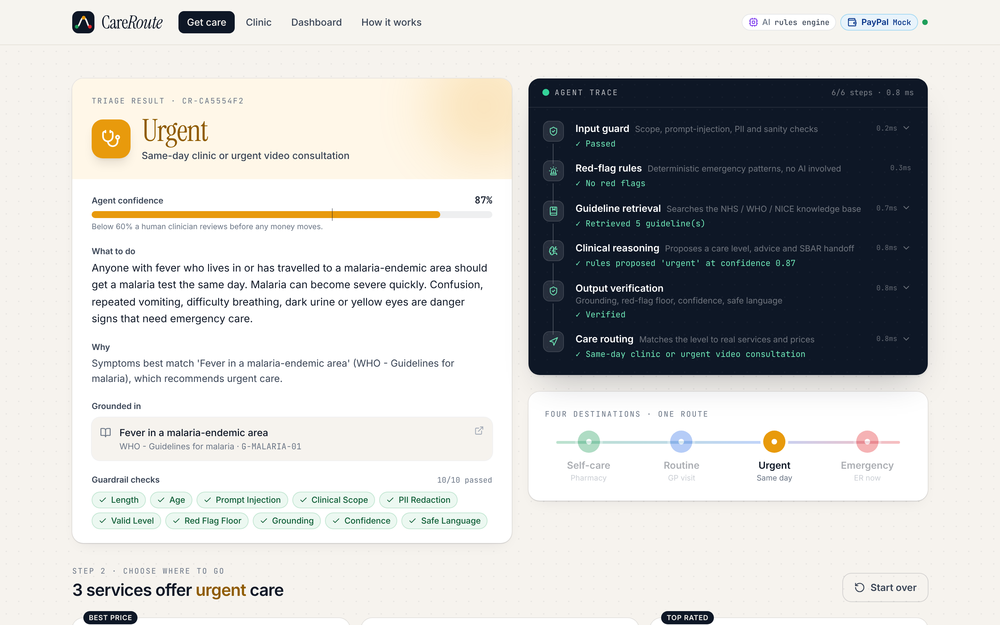
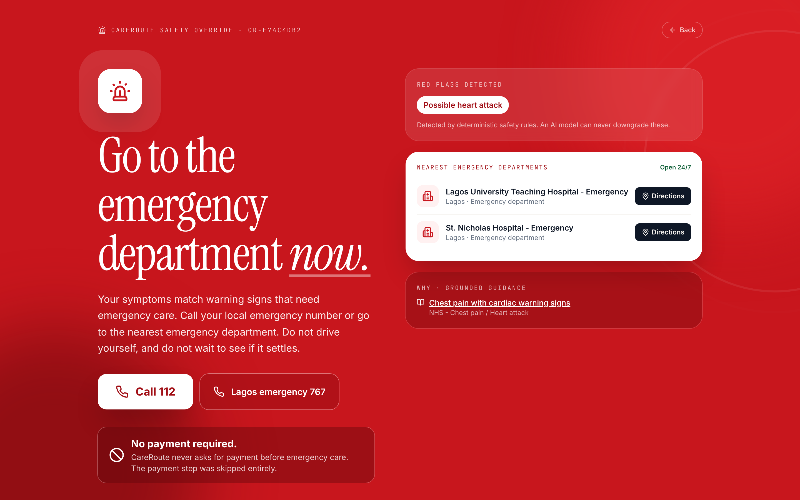
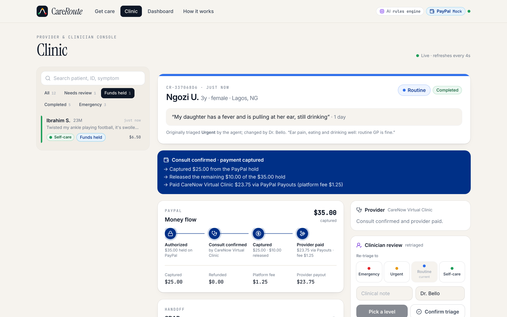
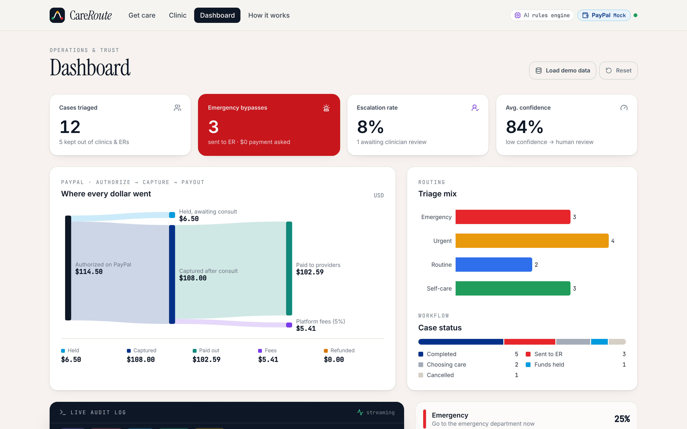

# CareRoute

**AI triage that gets patients to the right level of care, then pays for that care through PayPal.**

[](https://github.com/Emart29/HCRS/actions/workflows/ci.yml)


Built for the **PayPal AI Hackathon 2026**.

| Patient | Emergency | Clinic console | Trust dashboard |
|---|---|---|---|
|  |  |  |  |

---

## The problem

In much of the world, including Nigeria where this team is based, people pay for most healthcare **out of pocket and before they are seen**. Two problems follow:

1. **People pay for the wrong care.** Someone with a cold pays for a hospital visit. Someone having a heart attack waits in a queue to pay first.
2. **Payment gets in the way of urgent care.** "Pay first, then we'll see you" costs lives in emergencies.

Symptom-checker chatbots exist, but they stop at advice. None of them close the loop to *paying for the right care*, and very few publish how often they are wrong.

## What CareRoute does

> **Goal of the agent: get the patient to the right level of care, and pay for it safely.**

1. **Triage.** The patient describes their symptoms. The agent classifies the case as `emergency`, `urgent`, `routine` or `self_care`. Every decision is grounded in cited public guidelines (NHS, NICE, WHO) and checked by a guardrail layer written as code, not as prompt text.
2. **Route.** It recommends the right service and providers: pharmacist, telehealth, or same-day clinic.
3. **Pay safely with PayPal.**
   - The payment is **authorized, not captured**: funds are held and nothing is taken yet.
   - It is **captured only when the provider confirms the consultation took place.**
   - If a clinician **down-triages** the case (for example, a pharmacist was enough), the agent captures less, or partially refunds if the payment was already captured.
   - If a clinician **up-triages to emergency**, the hold is voided or the payment fully refunded.
   - The provider is paid through **PayPal Payouts**, minus a 5% platform fee.
4. **Emergencies never see a payment screen.** If a deterministic red-flag rule fires, the patient is sent to emergency care straight away. No checkout is shown, and the API refuses to create an order.

## How we use PayPal

| PayPal capability | Where it is used |
|---|---|
| **Orders v2, `intent: AUTHORIZE`** | `POST /v2/checkout/orders` when the patient picks a provider (`backend/app/payments/paypal.py`) |
| **JS SDK Buttons** | Patient approves in the PayPal popup (`frontend/`) |
| **Authorize order** | `POST /v2/checkout/orders/{id}/authorize`: funds held, not taken |
| **Capture authorization (full or partial)** | `POST /v2/payments/authorizations/{id}/capture` when the provider confirms the consult. The amount is reduced after a clinician down-triage. |
| **Void authorization** | No-show, cancellation, or up-triage to emergency |
| **Refund capture (partial or full)** | Down-triage after capture; escalation to emergency after capture |
| **Payouts v1** | Pays the provider the captured amount minus the platform fee |
| **Webhooks plus signature verification** | `POST /api/paypal/webhook`, verified with `/v1/notifications/verify-webhook-signature` |
| **Idempotency** | `PayPal-Request-Id` header on every money-moving call |

**The AI decides *when money moves*; PayPal moves it.** Without the triage decision there is nothing to pay for. Without PayPal's authorize, capture, void, refund and payout primitives, the "pay only for the right care" promise can't be kept.

## How we use AI

| Tool | Use |
|---|---|
| **Google Gemini** (`gemini-3.8-flash`, via the `google-genai` SDK) | Structured-output triage decision (JSON schema): level, confidence, reasoning, patient advice and an **SBAR clinical handoff note**, using *only* the retrieved guideline excerpts. The patient's text is fenced off as data so instructions inside it are ignored. |
| **BM25 retrieval** over a curated guideline knowledge base | Every decision must cite guidelines that were actually retrieved. |
| **Deterministic guardrail layer** (Python, unit-tested) | Input guard (scope, prompt injection, personal-data redaction), 14 red-flag rules, output verification (grounding, confidence, unsafe language). |
| **Rules engine fallback** | If Gemini is unavailable or rate-limited, the agent falls back to a deterministic engine and records it in the trace. It never crashes and never guesses. |
| **Claude Code** | Used as the engineering assistant to build the project. |

### The agent pipeline (visible in the UI for every case)

```
patient text
   │
   ▼
[1] Input guardrails ── off-topic? injection? personal data? ─────► block / redact
   │
[2] Red-flag rules (deterministic) ── e.g. chest pain + arm/jaw/sweating ─► floor = EMERGENCY
   │
[3] Retrieval (BM25 over NHS / NICE / WHO excerpts)
   │
[4] Gemini reasoning ── structured JSON, cites guideline IDs only
   │      └─ on failure ─► deterministic rules engine
[5] Output guardrails
   │      ├─ level valid?
   │      ├─ red-flag floor (the model can NEVER downgrade an emergency)
   │      ├─ grounding: citations must be retrieved guidelines, else escalate
   │      ├─ confidence < 0.6 ─► raise one level + send to a human clinician
   │      └─ strip doses / "you have X" diagnosis language
   ▼
[6] Routing ── emergency: ER, no payment │ else: providers + PayPal authorize
```

## Reliability (we publish our numbers)

`eval/scenarios.json` contains **61 labelled scenarios**: 22 emergencies, 13 urgent, 10 routine, 10 self-care, 3 ambiguous cases and 3 off-topic or adversarial inputs. CI runs the evaluation on every push and **fails the build if emergency recall drops below 100%**.

Latest run (deterministic engine, the CI baseline):

| Metric | Result |
|---|---|
| **Emergency recall** (emergencies sent to emergency care) | **100%** |
| **Under-triage rate** (sent to less urgent care than needed: the dangerous error) | **0%** |
| Exact level accuracy | 92.9% |
| Over-triage rate (safe, but costs the patient more) | 7.1% |
| Ambiguous cases escalated to a clinician instead of guessed | 100% |
| Off-topic requests refused | 100% |
| Decisions grounded in a cited guideline | 100% |

Full report: [`eval/results/REPORT.md`](eval/results/REPORT.md). With a Gemini key set, run `python eval/run_eval.py` to evaluate the LLM path.

> The eval set caught a real bug during development: "I want to kill myself" was being **blocked as off-topic** by the scope check. Red-flag language now always overrides the scope check, and a regression test guards it.

## Run it

### Option A: Docker (one command)
```bash
cp .env.example .env   # optionally add GEMINI_API_KEY and PayPal sandbox keys
docker build -t careroute . && docker run --rm -p 8000:8000 --env-file .env careroute
```
Open http://localhost:8000.

### Option B: local dev
Requires Python 3.11+ and Node 20+.
```bash
make install           # python venv + npm install
cp .env.example .env   # add keys (optional)
make api               # API on :8000
make web               # dashboard on :5173 (proxies /api to :8000)
```

**It works with no keys at all.** Without `GEMINI_API_KEY` it uses the deterministic engine. Without PayPal keys it runs a clearly labelled *simulated PayPal* flow. The header badges always show which mode is active. In the dashboard, click **Load demo data** to populate realistic cases.

### Deploy to Render
`render.yaml` is included: **New > Blueprint > select this repo**, then fill in the secret env vars.

### Turning on real PayPal sandbox payments
See **[docs/PAYPAL_SETUP.md](docs/PAYPAL_SETUP.md)**. It takes about 10 minutes: create a sandbox app, paste the client ID and secret, enable Payouts, and optionally register a webhook.

## Tests & quality

```bash
make test    # 48 unit + API tests: guardrails, agent, payment state machine, PayPal request shapes
make lint    # ruff + TypeScript typecheck
make eval    # reliability report
```
GitHub Actions (`.github/workflows/ci.yml`) runs lint, tests, the safety gate, the frontend build and the Docker build.

## Repository layout

```
backend/app/
  agent/          orchestrator (pipeline + trace), Gemini engine, rules engine
  guardrails/     input_guard, red_flags, output_guard   <- testable safety layer
  knowledge/      guidelines.json (NHS/NICE/WHO excerpts), providers.json, BM25 retrieval
  payments/       PayPal REST client + mock gateway (same interface)
  service.py      care/payment state machine (authorize -> capture -> payout, void, refund)
  main.py         FastAPI routes, webhook, serves the built dashboard
backend/tests/    pytest suite
eval/             labelled scenarios, runner, published results
frontend/         React + TypeScript + Tailwind dashboard
docs/             architecture, PayPal setup, demo script, submission text
```

## API

| Method | Path | Purpose |
|---|---|---|
| POST | `/api/triage` | Run the agent; creates a case |
| POST | `/api/cases/{id}/checkout` | Create PayPal order (AUTHORIZE) for the chosen provider |
| POST | `/api/cases/{id}/authorize` | Authorize after approval: funds held |
| POST | `/api/cases/{id}/confirm` | Provider confirms consult: capture and payout |
| POST | `/api/cases/{id}/cancel` | Void the hold |
| POST | `/api/cases/{id}/review` | Clinician confirms or re-triages (adjusts money automatically) |
| GET | `/api/cases`, `/api/cases/{id}`, `/api/stats`, `/api/events`, `/api/eval` | Dashboard data |
| POST | `/api/paypal/webhook` | PayPal webhook receiver |

Interactive docs: http://localhost:8000/docs

## Safety & scope

CareRoute is **decision support for routing, not a diagnostic tool**. It does not diagnose or prescribe, and it removes dosing or diagnostic claims from AI output. Uncertain cases go to a human clinician. Guideline excerpts are paraphrased from public NHS, NICE and WHO material and link to their sources. In an emergency, call your local emergency number.

## Team

- **Emart** ([@Emart29](https://github.com/Emart29)): agent, guardrails, evaluation, PayPal integration
- **Oladipupo Shado** ([@Oladipuposhado](https://github.com/Oladipuposhado)): architecture, guardrail and escalation design, demo

## License

[MIT](LICENSE)
